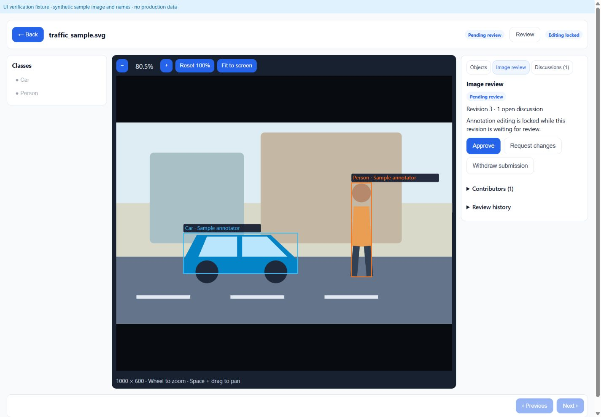
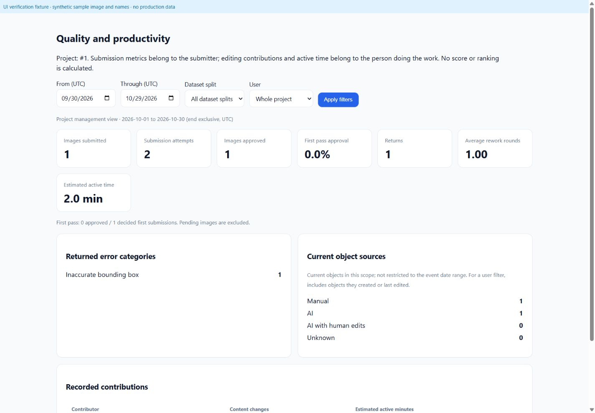

# Annotation quality workflow

Implemented in the existing FastAPI/SQLAlchemy application and React SVG editor.
Bounding boxes, polygon points, attribution, image splits and zoom/pan retain their
existing coordinate and permission contracts. There is no separate Dataset model
or image assignment model: a dataset belongs to a project, and scope filters use
its saved train, validation, test or unassigned split.

## Migration and rollout

`0010_annotation_quality` follows `0009_platform_admin`. It adds image review state,
content revision and review version, project `require_review` (default **false**),
prediction edit provenance, immutable content snapshots, review events, discussion
threads/comments, and activity records/cursors. Indexes cover project/status queues,
image/revision uniqueness, event type, user and time.

Existing images with live annotations become `in_progress`, revision 1. Other
images remain `not_started`, revision 0, with no negative-image confirmation.
Nothing is approved or attributed to a guessed user. Existing objects, IDs,
coordinates, timestamps and source fields are preserved. Baseline snapshots are
captured lazily on a content write or submission, never on GET/open.

Back up PostgreSQL and private storage first, verify the dump, then run from the
repository root:

```powershell
docker compose up -d --build backend frontend
# Backend startup runs: alembic upgrade head
docker compose exec backend alembic current
```

Never reset volumes or downgrade over live data. Restore a reviewed backup into a
separate database if recovery is needed. Migration intentionally refuses downgrade.

## States, revisions and permissions

| Current state | Action | Result |
| --- | --- | --- |
| not_started / in_progress / changes_requested | Save draft | Persist content without submitting |
| editable state | Submit for review | Save and submit atomically; pending_review |
| pending_review | Withdraw | in_progress; editing unlocked |
| pending_review | Request changes, category and reason required | changes_requested |
| pending_review | Independent approval | approved, tied to current revision |
| approved | Reopen for editing | in_progress; approval invalidated immediately |

An empty image requires the explicit “This image contains no objects to annotate”
checkbox to submit. Saving an empty draft is not a completed negative image.
Pending and approved images reject all annotation writes, including single/batch
save, deletion and AI acceptance. Reopen/withdraw changes the review version, not
the annotation content revision. No-op saves and comments change neither content
revision nor annotation attribution. Geometry, class reassignment, creation,
deletion and accepted AI predictions create content snapshots.

Every submit/decision supplies `expected_revision` and `expected_review_version`.
Stale or competing operations return 409 with reload guidance; object edits also
retain their existing expected-version checks. PostgreSQL workspace advisory locks
serialize mutations across workers, including legacy service commits. Save and
submit use one transaction. Snapshots retain exact object IDs, geometry, class,
source, creator/editor IDs and timestamps. Historical revisions can be read at
`GET /api/images/{id}/revisions/{revision}`.

| Role | Review capabilities |
| --- | --- |
| Viewer | Read annotations, queue, history and discussions; personal metrics only |
| Annotator | Existing annotation rights; save, submit, withdraw own submission; comment; resolve/reopen own threads; personal metrics |
| Reviewer | Existing labeling and strict creator-role correction hierarchy; submit, withdraw, approve, request changes, reopen; manage discussion state; personal metrics |
| Workspace Owner/Admin | Reviewer actions, project metrics, review settings and existing export rights |
| Platform Admin | No automatic workspace/project access and no self-approval exception |

Backend permission registry and current database memberships enforce every route.
Reviewer remains above Annotator for object corrections; equal/higher creator
roles remain protected. Permissions include `annotation.edit_others`, `review.submit`,
`review.approve/reject/reopen`, `export.approved`, and
`project.review_settings.manage`. The existing hierarchy limits edit_others.

**Independent review:** contributors include known original/current object authors
and every recorded content editor in the image's revision lineage, including
deletions and recorded editors of accepted AI proposals. This conservative lineage survives resubmission and reopening. A
contributor cannot approve, even as Owner/Admin. A reviewer who corrects content
must ask another independent reviewer. Merely submitting unchanged content is not
a content contribution. Confirming an empty image is a contribution. Unknown
legacy authors are displayed as unknown, not inferred.

## Export gate and discussions

In Project → Dataset Export, Owner/Admin can enable “Require review before export”.
Preview and ZIP generation share `export_selection`: total selected images,
eligible images, and excluded counts for every state are shown for the chosen
split. No eligible images disables the download and returns a clear API error.
With the setting enabled, export requires state approved, matching current and
approved revision, and an existing snapshot. Export reads immutable snapshot
objects under the workspace operation lock, so edits cannot change the contents
mid-export. Approved negatives produce empty YOLO label files. With the setting
off, existing live export, validation, class ordering and split behavior remain.
Both existing detection and segmentation YOLO paths use this gate.

Editor → Discussions supports image/object threads, replies, resolve and reopen.
Object links use saved IDs and select/highlight the existing canvas object without
altering viewport transforms. New unsaved objects must be saved first. Soft-deleted
objects retain discussions and show “Object deleted”. Comments do not change
revisions or approval. Open threads are shown to reviewers and do not block approval.
The most recent resolver and resolution time remain stored after reopening.

When an image/project is permanently deleted through the existing workflow,
quality history is **retained**, with its active image link set to null and original
image identity retained. Replies/snapshots remain stored; tenant APIs cannot access
detached history or accidentally attach it to a reused image ID. No purge or
historical recovery UI is added; an explicit operator retention policy is required
before any future purge feature.

## Metrics and activity estimates

Project → Quality dashboard filters by this project, current dataset split, user
(managers only), and UTC date range up to 366 days. Start is inclusive; end is
exclusive. UI “Through” includes that whole UTC calendar day. Annotators,
Reviewers and Viewers are restricted to their own metrics at the backend.

| Metric | Definition and attribution |
| --- | --- |
| Images submitted | Distinct image IDs submitted during period; submitter |
| Submission attempts | All submit events, including resubmissions; submitter |
| Images approved | Distinct images with approvals in period; original submitter of that submission |
| First pass approval | Submission-1 approvals / submission-1 approvals or returns, by decision date; pending/withdrawn excluded; null if no decisions |
| Returns | Change-request decisions in period, by submitter; grouped into six error categories |
| Average rework rounds | For each image approved in period, count all recorded returns before its latest approval, then average; null if none approved |
| Content contributions | Content-change transactions in period, credited to actual editor, not last submitter |
| Active time | Sum of accepted heartbeat intervals overlapping period, credited to actual active user |

Heartbeat: every 10 seconds while the editor is visible and activity is within
`ANNOTATION_ACTIVITY_IDLE_SECONDS` (default 60, bounded 15–300). Server caps each
interval to 15 seconds and actual server elapsed time; gaps over 25 seconds receive
zero credit. Per-user row locks, tab lease and sequence checks prevent overlapping
tabs/replayed pulses from adding time twice, even across workspaces. Browser tab
identity survives image navigation. First pulse establishes a baseline. This is
an estimate for management, **not an absolute performance measure**. It does not
count the entire open-to-save duration. Heartbeat failure never blocks saving.

Sources show Manual, AI, AI with human edits, or Unknown. New edits to predictions
and accepted AI objects are tracked; missing legacy provenance stays unknown.
Source totals are the current live object inventory, independent of event dates.
A user filter includes objects they created or last edited. Historical work before
installation has no invented events/time. There is no aggregate score or ranking.

## Manual acceptance with an Annotator and two Reviewers

1. Owner invites three members into a workspace: one Annotator and two Reviewers.
   Open an existing project or create a detection/segmentation project.
2. Annotator opens an image, zooms/pans, draws/edits and chooses **Save draft**.
   Verify state remains In progress and geometry matches after reload.
3. Choose **Image review → Submit for review**. For a negative image, remove objects
   and explicitly confirm the checkbox. Pending review locks all geometry controls.
4. Reviewer one opens **Review queue**, selects the image, adds an object thread,
   and requests changes with a category and reason.
5. Annotator sees the reason, edits, replies and resubmits. Reviewer one can approve
   if they made no content edits. If they corrected labels after withdrawal, they
   must ask Reviewer two; their own Approve button is disabled and API denies it.
6. Enable review before export. Check preview counts, download the ZIP, and inspect
   image/label alignment and empty labels for approved negatives. Reopen an approved
   image and verify it immediately disappears from eligibility until reviewed again.
7. Open the same pending revision as both Reviewers and decide concurrently. Only
   one succeeds; the other receives 409 and must reload.
8. Check dashboard counts with pending first submissions, returns and resubmissions;
   verify no-data rates. Open two tabs and hide/idle one to check bounded time.

## Automated validation

Verified on 2026-10-29:

- Full backend suite with the final code and deployed runtime: **170 passed**,
  including approved polygon snapshot export and proposal-editor self-approval
  prevention when another account accepts the AI result.
- Full frontend suite: **159 passed** in 21 files, including both bounding box and
  polygon discussion selection after zoom/pan.
- TypeScript and Vite production build passed. No lint command is configured.
- Isolated PostgreSQL migration and concurrent decisions passed (200/409); its
  disposable database was removed afterward.
- Local migration is `0010_annotation_quality (head)`. API health and frontend
  returned HTTP 200. Original project/image columns and every annotation column
  retained their pre-migration checksums. Review gating remained off for all old
  projects, with zero auto-approved images and zero invented snapshots.
- Private verified backups: `storage/.backups/annotation-before-quality-20261029.dump`
  and `storage/.backups/annotation-files-before-quality-20261029.tar.gz`. Before/after
  fingerprint files are stored alongside them. All are ignored by Git.

UI inspection used the actual editor/review/dashboard components with a temporary
local fixture and synthetic image/names. No production account or dataset was
used. The fixture server and entry files were removed after inspection.




```powershell
docker compose run --rm --no-deps backend pytest -q
cd frontend
npm test
npm run build
```

Tests cover state transitions, no-op drafts, atomic failure rollback, negative
confirmation, self approval, stale decisions, edit locks, tenant permissions,
snapshot export, reopening, discussions/deleted IDs, no-data formulas and heartbeat
deduplication. Frontend tests include actual canvas zoom/pan plus discussion
selection and successful/failed submission behavior. PostgreSQL integration script
`backend/scripts/verify_quality_postgres.py` refuses databases unless their name
starts with `annotation_phase6_test_quality_`; it checks real concurrent 200/409
decisions and is only for an isolated disposable database.

No formatter/lint command is configured. Realtime chat, mentions, attachments,
assignment changes and retrospective time reconstruction are outside this update.
