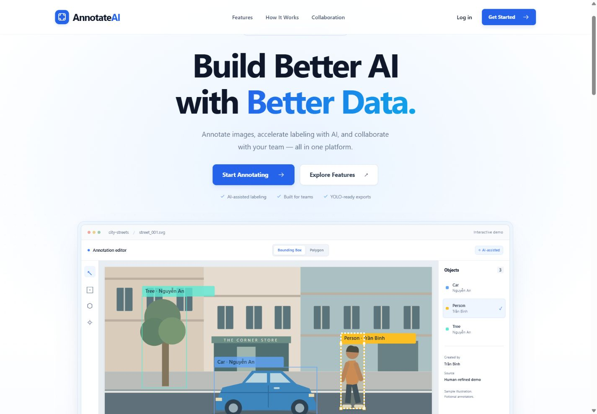

# AnnotateAI — Data Annotation Platform

AnnotateAI is a full-stack platform for preparing computer-vision datasets. Teams can organize images, draw bounding boxes or polygons, review YOLO suggestions, collaborate in workspaces, and export YOLO-ready datasets.

## Features

Platform administration is available at `/admin` with a separate platform-level
role, live dashboard, user controls and metadata-only workspace/project views.
An existing verified account must be explicitly granted access through the trusted
CLI. See [Platform Admin setup](PHASE6_7_PLATFORM_ADMIN.md).

Existing annotations can be corrected directly: move/resize a box, drag polygon
vertices, or change an object's class, then Save while retaining its ID and
creator. Hierarchy permissions and soft-delete audit are enforced by the backend.
See [in-place correction guide](PHASE6_6_CORRECTION.md).

Sessions expire after 60 minutes without user activity, with a warning 5 minutes
before expiry. See [session inactivity policy](PHASE6_5_IDLE_SESSION.md) for setup,
multi-tab behavior and unsaved annotation handling.

- **Image annotation** — bounding boxes for object detection and polygons for instance segmentation.
- **AI-assisted labeling** — YOLO detection and segmentation suggestions; review, refine, accept, or reject each proposal.
- **Team workspaces** — verified-email invitations and Owner, Admin, Annotator, Reviewer, and Viewer roles.
- **Annotation attribution** — show the creator, latest editor, timestamps, source, and stable ID for every saved object.
- **Dataset workflow** — image/class management, persistent train/validation/test split, and YOLO export.
- **Authentication** — JWT access tokens, rotating refresh cookies, email verification, password reset, SMTP delivery support.
- **Responsive landing page** — public route at /; the application remains protected at /projects.

### Zoom and pan in the annotation editor

Use **+ / −** or the mouse wheel inside the black workspace to zoom. Wheel zoom
keeps the image point under the cursor fixed. Hold **Space** and drag with the
left mouse button to pan; drawing and object editing are suspended during pan.

**Reset 100%** displays one original image pixel per CSS pixel and centers the
image. **Fit to screen** scales the entire image into the available workspace,
preserving its aspect ratio; it also adapts when the workspace is resized.
Large images can extend beyond the clipped workspace at 100%; pan or use Fit
to inspect the rest. Zoom ranges from 5% to 800%, extending that range when
necessary to keep Fit available for very large or small images.

Bounding boxes, polygon vertices, and AI suggestions share the image transform.
Their saved coordinates remain in original image pixels. Zoom and pan alone
do not mark annotations as changed. A successful **Save** resets to centered
100% and keeps the saved annotations visible; a failed save keeps the viewport
and unsaved edits so you can retry. Opening another image starts in Fit mode.

## Technology

| Layer | Technology |
| --- | --- |
| Frontend | React, Vite, TypeScript, React Router |
| Backend | FastAPI, SQLAlchemy, Alembic |
| Database | PostgreSQL 16 |
| Canvas | SVG + React |
| AI | Ultralytics YOLO |
| Deployment | Docker Compose |
| Tests | Pytest, Vitest, Testing Library |

## Quick start

### Requirements

- Docker Desktop with the Linux container engine running
- Docker Compose v2

### 1. Clone and configure

~~~bash
git clone https://github.com/MouhJi/annotation-platform.git
cd annotation-platform
~~~

Create a private local environment file.

**PowerShell**

~~~powershell
Copy-Item .env.example .env
~~~

**macOS/Linux**

~~~bash
cp .env.example .env
~~~

### 2. Start the stack

~~~bash
docker compose up --build
~~~

Open:

| Service | URL |
| --- | --- |
| Landing page and web app | http://localhost:5173 |
| API documentation | http://localhost:8000/docs |
| Health check | http://localhost:8000/health |

The backend applies Alembic migrations automatically. Uploaded images and model files live under storage/; PostgreSQL data stays in the postgres_data Docker volume.

Run in the background:

~~~bash
docker compose up -d --build
~~~

See backend logs:

~~~bash
docker compose logs -f backend
~~~

Stop containers without deleting data:

~~~bash
docker compose down
~~~

> Do not run docker compose down -v unless you intentionally want to erase the PostgreSQL volume.

## First-use workflow

1. Open http://localhost:5173 and choose **Get Started**.
2. Register and verify your email when verification is enabled.
3. Create or select a workspace.
4. Create a project:
   - **Object Detection** for bounding boxes.
   - **Instance Segmentation** for polygons.
5. Add classes and upload images.
6. Open an image, annotate manually or run AI-assisted labeling.
7. Click **Save**.
8. Configure Train / Validation / Test on Project Detail and download the YOLO export.

## Annotation modes

### Object Detection

Choose a class, select **Bounding Box**, then drag over an object.

~~~text
class_id x_center y_center width height
~~~

### Instance Segmentation

Choose a class, select **Polygon**, click vertices, then double-click, press Enter, or choose **Finish polygon**. Escape/Cancel discards the unfinished shape.

The backend checks that polygons have three or more distinct points, non-zero area, no self-intersection, and vertices inside the image.

~~~text
class_id x1 y1 x2 y2 x3 y3 ...
~~~

## AI-assisted labeling

Set model locations in your private .env. The Docker defaults are:

~~~dotenv
YOLO_MODEL_PATH=/app/storage/models/yolo11n.pt
YOLO_DEVICE=cpu
YOLO_CONFIDENCE_THRESHOLD=0.25

YOLO_SEG_MODEL_PATH=/app/storage/models/yolo11n-seg.pt
YOLO_SEG_DEVICE=cpu
YOLO_SEG_CONFIDENCE_THRESHOLD=0.25
~~~

The model loads only on the first inference request. Put a compatible model file in storage/models/, or permit Ultralytics to retrieve the configured public model at first use.

Pending AI results are visually distinct from saved labels. Accepting one creates an official annotation credited to the accepting member, with source marked AI-assisted. Missing classes are created only when their proposal is accepted.

## YOLO dataset export

Project Detail lets you save persistent **Train / Validation / Test** percentages. The default is **80 / 10 / 10**. Each image receives one stable split, so later exports are consistent.

An export archive contains:

~~~text
<project-name>/
├── data.yaml
├── images/
│   ├── train/
│   ├── val/
│   └── test/
└── labels/
    ├── train/
    ├── val/
    └── test/
~~~

Images without annotations are included with an empty label file. Class IDs are zero-based and follow the stable project-class order.

Train with Ultralytics after extracting the ZIP:

~~~bash
yolo detect train data=/path/to/dataset/data.yaml model=yolo11n.pt epochs=50
yolo segment train data=/path/to/dataset/data.yaml model=yolo11n-seg.pt epochs=50
~~~

## Workspaces and roles

Every project belongs to a workspace. The backend checks workspace membership and role permissions for every protected resource.

| Role | Typical access |
| --- | --- |
| Owner | Full control, including workspace deletion |
| Admin | Team and project administration |
| Annotator | Create/edit labels; run and review AI suggestions |
| Reviewer | Review labels and AI suggestions |
| Viewer | Read-only projects, images, and attribution |

Saved annotations retain the original creator even if another member edits them later. A stale concurrent save returns a reload message instead of overwriting the latest data.

## Email configuration

The default is offline development mode:

~~~dotenv
EMAIL_PROVIDER=file
~~~

Development messages are written privately to storage/.emails/ and do not reach an inbox.

For SMTP delivery, fill these values in the **untracked** .env, then restart the backend:

~~~dotenv
EMAIL_PROVIDER=smtp
SMTP_HOST=smtp.gmail.com
SMTP_PORT=587
SMTP_USE_STARTTLS=true
SMTP_USERNAME=your-sender@example.com
SMTP_PASSWORD=your-app-password
SMTP_FROM_EMAIL=your-sender@example.com
SMTP_FROM_NAME=AnnotateAI
~~~

For Gmail, use a Gmail App Password, not the normal account password.

## Important environment variables

Start from [.env.example](.env.example).

| Variable | Purpose |
| --- | --- |
| APP_ENV | development, test, or production |
| JWT_SECRET_KEY | 32+ character secret required in production |
| CORS_ORIGINS | Comma-separated browser-origin allowlist |
| FRONTEND_URL | Public app URL used in email links |
| AUTH_COOKIE_SECURE | Set true behind HTTPS |
| EMAIL_PROVIDER | file for offline development or smtp for delivery |
| EMAIL_VERIFICATION_REQUIRED | Require verified email before normal account use |
| YOLO_MODEL_PATH / YOLO_SEG_MODEL_PATH | Model file locations |
| YOLO_DEVICE / YOLO_SEG_DEVICE | cpu or a supported CUDA device |

Production requires HTTPS, explicit CORS origins, secure cookies, a strong JWT secret, a public FRONTEND_URL, and SMTP.

## Project structure

~~~text
.
├── backend/
│   ├── app/
│   │   ├── models/       # SQLAlchemy domain models
│   │   ├── routers/      # FastAPI endpoints
│   │   ├── schemas/      # API schemas
│   │   └── services/     # AI, export, auth, email, RBAC
│   ├── alembic/          # database migrations
│   └── tests/
├── frontend/
│   ├── src/
│   │   ├── components/
│   │   ├── pages/
│   │   ├── hooks/
│   │   ├── auth/
│   │   └── workspaces/
│   └── public/
├── storage/              # private runtime data; ignored by Git
├── docker-compose.yml
└── .env.example
~~~

## API overview

All APIs use the /api prefix. Interactive OpenAPI documentation is available at http://localhost:8000/docs.

| Area | Example endpoints |
| --- | --- |
| Authentication | POST /api/auth/register, POST /api/auth/login, POST /api/auth/refresh |
| Workspaces | GET /api/workspaces, POST /api/workspaces/{id}/invitations |
| Projects | GET/POST /api/projects, GET /api/projects/{id} |
| Images | POST /api/projects/{id}/images, GET /api/images/{id} |
| Annotations | GET/POST /api/images/{id}/annotations, PUT /api/images/{id}/annotations |
| AI review | POST /api/images/{id}/auto-label, POST /api/predictions/{id}/accept |
| Dataset | PUT /api/projects/{id}/dataset/split, POST /api/projects/{id}/dataset/export/yolo |

## Local development

### Backend

~~~bash
cd backend
python -m venv .venv
# Windows PowerShell:
.\.venv\Scripts\Activate.ps1
# macOS/Linux:
# source .venv/bin/activate

pip install -r requirements.txt
alembic upgrade head
uvicorn app.main:app --reload --port 8000
~~~

Configure DATABASE_URL, STORAGE_PATH, auth, CORS, and email settings first. SQLite is suitable for small local tests; PostgreSQL is required for complete workspace collaboration.

### Frontend

~~~bash
cd frontend
npm ci
npm run dev
~~~

The Vite server runs at http://localhost:5173. Configure VITE_API_URL if your backend is elsewhere.

## Tests

Run tests inside Docker:

~~~bash
docker compose run --rm --no-deps backend python -m pytest -q
docker compose run --rm --no-deps frontend sh -c "npm test && npm run build"
~~~

Or run them directly:

~~~bash
cd backend
pytest

cd ../frontend
npm test
npm run build
~~~

Tests use isolated database/storage configuration and file-mode email. They do not send real email or require a YOLO model download.

## Push this project to GitHub

1. Create a new empty repository on GitHub.
2. From the project directory, verify that secrets and private data are ignored:

   ~~~powershell
   git status --short
   git check-ignore .env storage/.auth-secret storage/.emails
   ~~~

3. Initialize and push:

   ~~~powershell
   git init
   git add .
   git status
   git commit -m "Initial commit: AnnotateAI data annotation platform"
   git branch -M main
   git remote add origin https://github.com/<your-github-username>/<your-repository-name>.git
   git push -u origin main
   ~~~

If Git is already initialized, skip git init. Before git add ., check that git status does **not** include .env, storage/, *.pt, backend/annotation.db, or frontend/node_modules/.

## Documentation

- [Authentication and account management](PHASE5_AUTH.md)
- [Workspace collaboration and RBAC](PHASE6_WORKSPACES.md)
- [Real email delivery](PHASE6_2_EMAIL.md)
- [Annotation attribution](PHASE6_3_ATTRIBUTION.md)
- [Landing page implementation](PHASE6_4_LANDING.md)

## Known limitations

- The SVG editor supports box movement/resizing and polygon vertex dragging; interactive zoom/pan and adding/removing polygon vertices are not implemented.
- One segmentation label stores one polygon. Holes and disconnected mask components are not represented losslessly.
- Attribution stores the creator and latest editor, not a complete edit history.
- Very small datasets may have an empty validation or test split.
- SMTP acceptance does not prove inbox arrival.
- Localhost deployment is intended for the host machine; use a reachable HTTPS domain for external collaborators.

## License

No license file is currently included. Add a license before publishing or accepting external contributions.

